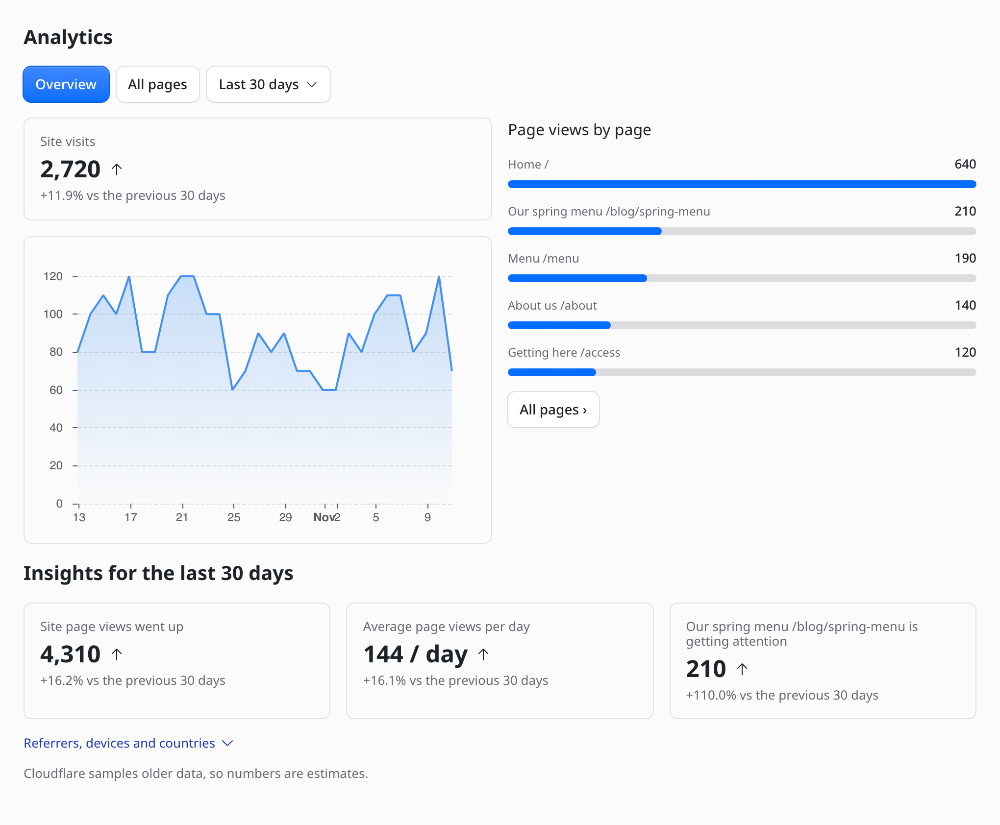
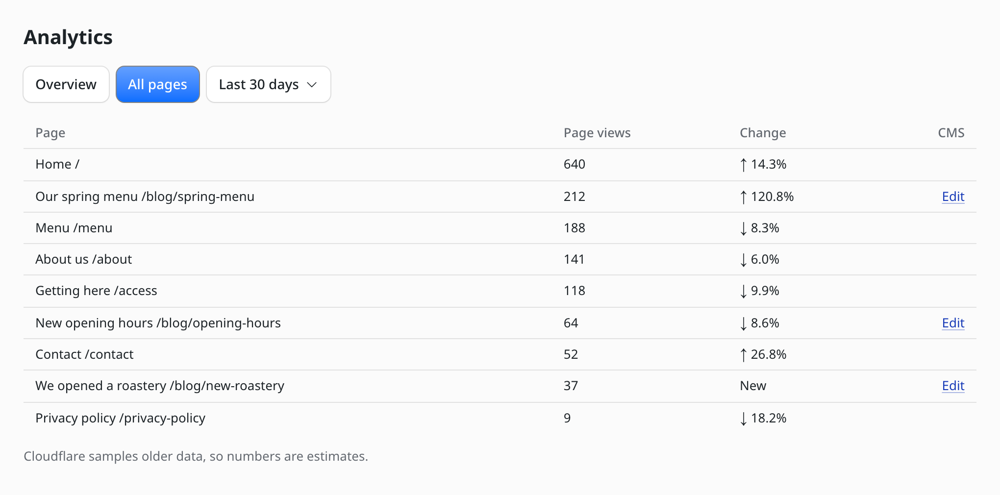

# Cloudflare Web Analytics for EmDash

A lightweight [EmDash CMS](https://emdashcms.com) plugin that shows your site's [Cloudflare Web Analytics](https://developers.cloudflare.com/web-analytics/) in the admin, so editors can see how the site is doing without a Cloudflare login.

If your pages already load the Web Analytics beacon, there is almost nothing to set up:

- **Four settings:** account ID, site tag, API token and time zone.
- **No cron, no sync, no tables:** the plugin reads Cloudflare live and reuses each result for 5 minutes.
- **Workers Free:** it runs in process without a sandbox runner, or sandboxed where you have one.

What editors get:

- **Overview:** site visits for the last 7, 30 or 90 days with a daily chart, the top pages, and insights on page views and the fastest-growing page, each compared with the period before. Referrers, devices and countries are one click away.
- **All pages:** every page's views and its change from the previous period, with links to open the page and, for pages that show a CMS entry, to edit it.
- **Dashboard widget:** the last 7 days at a glance.
- **English and Japanese:** the page and widget follow the admin's language.





The screenshots use made-up data.

This is a community plugin. It is not made or endorsed by Cloudflare.

## Requirements

- An EmDash site whose pages already load the Web Analytics beacon. The plugin only reads data; it does not add the beacon.
- `EMDASH_ENCRYPTION_KEY` set on the site, so EmDash can encrypt the API token. See [Manage secrets and keys](https://docs.emdashcms.com/deployment/secrets/#the-encryption-key).

## Install

```sh
pnpm add @chiji1108/emdash-plugin-cloudflare-analytics
```

Register the plugin in `astro.config.mjs`. It is sandbox-compatible, so it runs under a [sandbox runner](https://docs.emdashcms.com/deployment/plugin-sandbox/):

```js
import cloudflareAnalytics from "@chiji1108/emdash-plugin-cloudflare-analytics";

emdash({
	sandboxed: [cloudflareAnalytics],
	sandboxRunner: sandbox(),
});
```

A site without a sandbox runner, such as one on the Workers Free plan, can run it in process instead with `plugins: [cloudflareAnalytics]`.

## Configure

Open **Plugins → cloudflare-analytics → Settings** in the admin and fill in:

| Setting | Where to find it |
| --- | --- |
| Account ID | The account home page of the Cloudflare dashboard. |
| Site tag | Open the site under **Analytics & Logs → Web Analytics**. The tag is the last part of the page URL. It is not the token in the beacon snippet. |
| API token | Create one under **My Profile → API Tokens** with the **Account → Account Analytics → Read** permission, limited to the account above. |
| Time zone | An IANA name such as `Asia/Tokyo`. Days in the report start at midnight in this zone. The default is `UTC`. |

## How it reads data

The plugin queries the `rumPageloadEventsAdaptiveGroups` dataset of the [GraphQL Analytics API](https://developers.cloudflare.com/analytics/graphql-api/) and leaves out traffic Cloudflare marks as bots.

- Cloudflare keeps Web Analytics data for six months. It samples older data, so the numbers are estimates, as they are in the Cloudflare dashboard.
- The GraphQL API limits queries by cost, about 300 per 5 minutes. The plugin asks for [account-based limits](https://developers.cloudflare.com/analytics/graphql-api/account-based-rate-limiting/), so its budget is not shared with your other tokens. The widget queries 2 datasets per load and the analytics page 7, and each result is reused for 5 minutes.
- Web Analytics records paths, not page names. The plugin learns a page's name from its title the next time the site renders it, and only for paths the report has listed, so the names fill in over the first hour or so after installing. Until then the report shows the path.
- Days are grouped from hourly data. In a time zone whose offset is not a whole hour, such as `Asia/Kolkata`, a day's boundary can be off by up to 30 minutes.

## Alternatives

[@eisbachcode.de/analytics](https://plugins.emdashcms.com/plugins/@eisbachcode.de/analytics) also brings Cloudflare Web Analytics into EmDash, with a different design. Pick by what you need:

| | This plugin | @eisbachcode.de/analytics |
| --- | --- | --- |
| Numbers | Read live from Cloudflare on each load (reused for 5 minutes) | Synced daily into its own store, so older days stay exact instead of sampled |
| Per entry | Page list with names and a link to each CMS entry | Views per entry, an Analytics panel in the entry editor, MCP tools |
| Page names | Learned from each page's title, so static pages get names too | CMS entries, matched through each collection's URL pattern |
| Setup | Four settings; no cron, runs on Workers Free in process | Needs a Cron Trigger; the author recommends Workers Paid |
| Languages | English and Japanese | English and German |

## Develop

```sh
pnpm install
pnpm run validate
pnpm run typecheck
pnpm run test
pnpm run build
```

`pnpm run test` builds the plugin and runs it through EmDash's sandbox host with a mocked Cloudflare API.

## License

MIT
